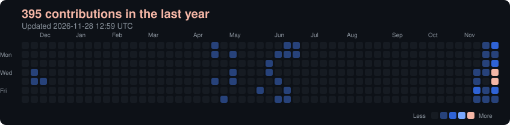

<!-- Intro: typing text on the left, Nyan Cat on the right -->

 

  
  
  

## 🛠️ Tech stack

  
  
  
  
  
  
  
  

## 🚀 Featured projects

  

  
  

## 📈 GitHub stats

  
  

  

  

## 📅 Contribution activity

  

